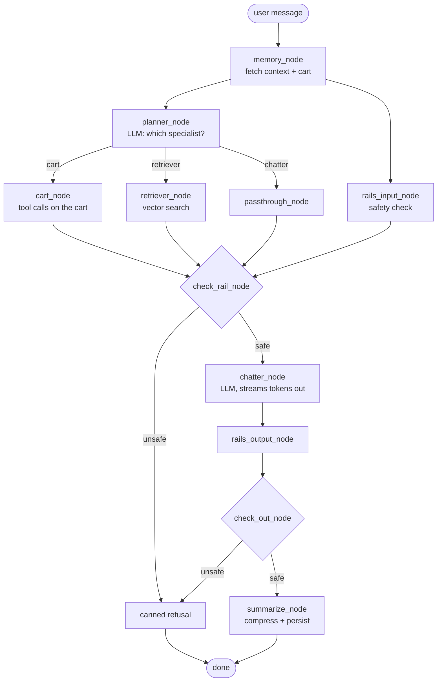
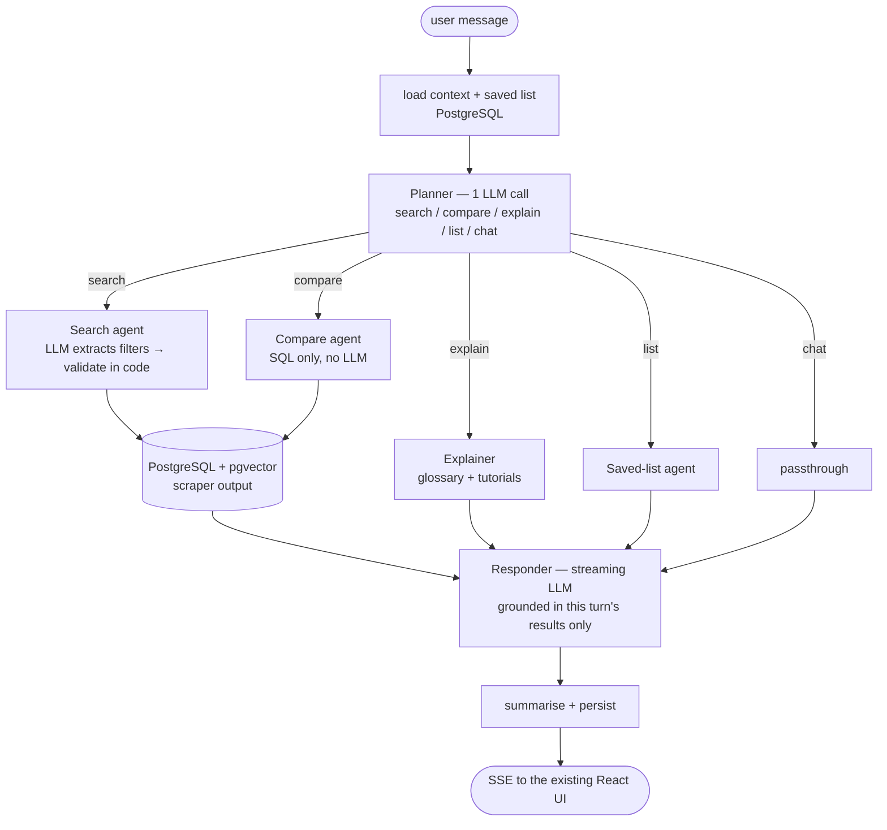

# How the NVIDIA blueprint's agents work — and what RobotEshop should copy

**Subject:** [NVIDIA-AI-Blueprints/retail-shopping-assistant](https://github.com/NVIDIA-AI-Blueprints/retail-shopping-assistant)
**Written for:** BSEF23-02 FYDP review (RobotEshop)
**Date:** 2026-08-15
**Read alongside:** `FYDP-DSE_005_Proposal_Template.pdf`, `scraper/README.md`, `README.md`

This document has two halves.

- **Part A** explains, in detail, how the agents in the NVIDIA repository actually work — read from the source, not from its marketing README.
- **Part B** is the review you asked for: which parts of that design RobotEshop should build, which parts it must not, and why.

---

## First, a word about the word "agent"

Your proposal uses "agent" in two different senses, and mixing them up will cost
you marks in the defence. They are unrelated systems:

| Sense | Where it appears | What it really is |
|---|---|---|
| **Scraping agent** | Proposal §5: *"automated web scraping agents … such as Scrapy"* | A crawler. No AI. Deterministic CSS/regex extraction. **You have already built this** — `scraper/` |
| **LLM agent** | Proposal §10: *"a dedicated AI chatbot"* | An LLM given a role, a prompt, and tools, wired into a graph. **This is what the NVIDIA repo is** |

Part A is entirely about the second sense.

---

# Part A — How the NVIDIA blueprint works

## A1. It is not one program; it is six containers

`docker-compose.yaml` brings up seven services. The agents live in exactly one of them.

| Service | Port | Role | Lines of code |
|---|---|---|---|
| **chain-server** | 8009 | **All five agents + the graph that routes between them** | ~2,100 |
| catalog-retriever | 8010 | Embeds the product CSV, stores it in Milvus, answers similarity queries | ~1,150 |
| memory-retriever | 8011 | SQLite store of per-user conversation context and cart | ~225 |
| rails | 8012 | NeMo Guardrails — input/output safety filter | ~150 |
| milvus (+ etcd, minio) | 19530 | Vector database | third-party |
| frontend | — | React UI (this is the UI you have already copied into `ui/`) | — |
| nginx | 3000 | Reverse proxy | — |

The hardware line in their README is the one to notice:

> **Hardware**: 4x H100 GPUs (preferred) or 4x A100 GPUs (minimum) for local deployment

That is because the blueprint runs three NVIDIA NIM models locally: a
**120-billion-parameter** LLM (`nvidia/nemotron-3-super-120b-a12b`), a text
embedding model (`nv-embedqa-e5-v5`), and an image embedding model (`nvclip`).
Four H100s is roughly **US$100,000+** of hardware, or about **$12–15/hour**
rented. There is a `config-build.yaml` override that points at NVIDIA's hosted
API instead — that path needs no GPU, and it is the only path relevant to you.

## A2. The five agents

All five live in `chain_server/src/`. Every one of them is a small Python class
with an `invoke(state)` method. There is no autonomous "agent loop" anywhere —
no agent decides to call another agent. **A fixed graph decides.**

| File | Class | Uses an LLM? | What it does |
|---|---|---|---|
| `planner.py` | `PlannerAgent` | Yes — 1 call | Reads the query, outputs one word: `cart`, `retriever`, or `chatter` |
| `retriever.py` | `RetrieverAgent` | Yes — 1 call | Turns "dresses under $100" into `{entities, categories, filters}`, then calls the catalog service |
| `cart.py` | `CartAgent` | Yes — 1 call | Tool-calls `add_to_cart` / `remove` / `view` / `total`; resolves fuzzy names to real catalog rows |
| `chatter.py` | `ChatterAgent` | Yes — 1 streaming call | **Writes the answer the user sees.** Always runs, last |
| `summarizer.py` | `SummaryAgent` | Sometimes | Compresses the conversation when it exceeds 16,384 chars, then persists it |

So a single user message costs **2–3 LLM calls**, not one.

## A3. The State object — the thing that flows between agents

Everything is one Pydantic model, `chain_server/src/agenttypes.py`:

```python
class State(BaseModel):
    user_id: int
    query: str            # what the user typed
    context: str          # summarised history of the conversation
    cart: Cart            # authoritative cart contents
    response: str         # written by whichever specialist ran
    image: str            # base64, if the user uploaded a photo
    retrieved: Dict[str, str]   # {product_name: image_url} from this turn only
    next_agent: str       # set by the planner
    guardrails: bool
    timings: Dict[str, float]   # every step is timed
```

Two fields carry most of the design weight:

- **`retrieved`** is wiped and refilled every turn. It is the *allowlist* of
  products the final responder is permitted to name. This is how they stop the
  LLM inventing products.
- **`context`** is a *summary*, not a transcript. It is deliberately marked
  "not authoritative" when handed to the responder.

## A4. The graph

`chain_server/src/graph.py` builds a LangGraph state machine. This is the whole
architecture in one picture:



Three things in that diagram are worth stealing outright:

1. **The planner and the safety check run in parallel.** `memory_node` fans out
   to both. The graph then joins them at `check_rail_node`. The safety check is
   therefore free in wall-clock terms — it overlaps with real work.
2. **Exactly one specialist runs per turn.** It is a router, not a debate.
3. **The chatter always runs last, and it is the only agent that talks to the
   user.** Specialists produce *data*; the chatter produces *prose*.

## A5. Agent by agent

### The Planner — a one-word classifier

`planner.py` sends the query plus a ~50-line routing prompt (in
`shared/configs/chain_server/config.yaml`) at `temperature=0.0, max_tokens=100`,
and expects one token back: `cart_node`, `search`, or `chatter`.

Everything around that call is defensive:

```python
mappings = {"search": "retriever", "cart_node": "cart",
            "product_finder": "retriever", "general": "chatter", ...}
normalized = mappings.get(agent_name, agent_name)
if normalized not in self.agent_choices:
    logger.warning(f"Invalid agent choice '{normalized}', defaulting to 'chatter'")
    return "chatter"
```

If the LLM returns garbage, or the call throws, it falls back to `chatter`.
**The system degrades to a plain chatbot rather than crashing.** Note also that
the planner is deliberately given the query *without* the conversation context —
their comment says this is "to avoid routing bias."

The routing prompt itself encodes one genuinely subtle distinction, and it is
worth understanding because your domain has the same problem:

- *"show me dresses under $100"* → `search` (has a product type)
- *"show me anything under $100"* → `chatter` (constraint only — **ask a
  clarifying question instead of guessing**)

### The Retriever — natural language into a structured query

`retriever.py` is the most instructive file in the repo. It does **not** throw
the user's sentence at a vector database. It first runs an LLM extraction step
with a forced tool schema, `extract_retrieval_inputs`, producing:

```json
{ "search_entities": ["earrings"], "category_one": "earrings",
  "min_price": null, "max_price": 200 }
```

The system prompt for that extraction is ~90 lines of ordered decision logic —
attribute follow-up → new product type → open-ended browse — with worked
examples for each. Then the *code*, not the LLM, cleans up after it:

- `_sanitize_categories()` drops any category the LLM invented that is not in the
  configured allowlist.
- `_normalize_filters()` throws away `max_price: 0`, because — in their own
  comment — *"LLMs frequently fill optional price parameters with 0 when the user
  did not mention a budget."* A `max_price=0` would silently return nothing.
- Blank entities are stripped, because the embedding endpoint 400s on empty input.

**This is the single most important lesson in the repository: let the LLM
propose a structured query, then validate it in ordinary code before it touches
your database.**

The catalog service (`catalog_retriever/src/retriever.py`) then does the search:
embed the text, cosine-search Milvus, keep the top-k above a 0.5 similarity
threshold, apply price filters to that window, then filter by category. With an
image attached it searches text and image collections concurrently
(`asyncio.gather`), merges by score, and **skips category filtering entirely** —
image similarity is trusted to be the better signal.

### The Cart agent — where the real engineering is

At 807 lines, `cart.py` is the biggest file, and almost none of that is prompting.
The problem it solves: the user says *"add the second one"* or *"add that blazer"*,
and the cart needs an exact catalog row.

- Six tool schemas (`add`, `bulk_add`, `remove`, `bulk_remove`, `view`, `total`).
- `_resolve_catalog_match()` — a four-stage name resolver: exact normalised
  match → substring containment → Jaccard token overlap → fall back to top
  embedding hit only if it clears 0.5 similarity. Their comment explains why
  embeddings alone fail here: *"distinctive product names are systematically
  underrated by similarity against full descriptions."*
- Prices are extracted with a regex (`PRICE:\s*([0-9.]+)`) and cached per cart
  line, so **totals are summed in Python, never by the LLM** — *"LLMs are
  unreliable for arithmetic."*
- Pronoun references (`it`, `this`, `both`, `those`) are matched by regex and
  resolved against the last products shown, not sent to the model.

### The Chatter — the grounding layer

`chatter.py` never sees raw state. It is handed a hand-built, labelled block:

```
USER QUERY: ...
PRECEDING AGENT (ran this turn before you): cart | retriever | none
PRECEDING AGENT RESULT (verbatim, authoritative for this turn): ...
CURRENT CART (authoritative): - 1 x Midnight Velvet Blazer @ $89.00
AVAILABLE CATALOG (fresh retrieval this turn; the only NEW products you may name): ...
RECENT DISCUSSION (reference only; NOT authoritative for cart state): ...
```

Every field is explicitly ranked by trustworthiness, and the system prompt
enforces it:

> **NEVER SELF-EXECUTE CART ACTIONS.** … You may only state that an item was
> added when PRECEDING AGENT is `cart` AND the result explicitly confirms it —
> even if RECENT DISCUSSION contains such phrases.

That rule exists because a summarised history containing *"I've added the blazer
to your cart"* will otherwise make the model claim it did so again. This is the
classic multi-turn hallucination in shopping assistants, and the fix is
structural: separate authoritative fields from reference fields, and say so in
the prompt.

The chatter is the only streaming agent. It emits two message types over
Server-Sent Events via LangGraph's `get_stream_writer()`:

```json
{"type": "images",  "payload": {"Product Name": "/images/x.jpg"}, "timestamp": …}
{"type": "content", "payload": "token", "timestamp": …}
```

then `data: [DONE]`. **That is precisely the protocol
`mock-server/server.js` already reimplements**, which is why the NVIDIA UI in
`ui/` runs against your mock backend unmodified.

### The Summarizer — memory hygiene

Only fires when `len(context) > 16384`. Its prompt forbids dropping product
facts ("NEVER remove or shorten product specifications, even to save space")
while allowing greetings and filler to be compressed. Then it POSTs the context
to the memory service. Note the ordering: **summarise, then persist** — so what
is stored is what the next turn will see.

### Guardrails — the part that is nearly empty

`guardrails/` is 150 lines wrapping NeMo Guardrails. Input and output are each
checked by asking the rails LLM to regenerate the message; if what comes back is
byte-identical to what went in, it is judged safe. On any exception it **defaults
to safe**. The refusal is a single canned string from config.

## A6. What one query actually costs

For *"show me dresses under $100"*:

| Step | Work |
|---|---|
| memory_node | 2 HTTP GETs (context, cart) |
| rails_input_node | 1 LLM call — **in parallel** with the planner |
| planner_node | 1 LLM call → `retriever` |
| retriever_node | 1 LLM call (extraction) + 1 embedding call + 1 Milvus search |
| chatter_node | 1 streaming LLM call |
| rails_output_node | 1 LLM call |
| summarize_node | 0 or 1 LLM call + 1 HTTP POST |

**5–7 model calls per user message.** Every step is timed into `state.timings`
and exposed at `/query/timing` — a detail worth copying for your evaluation
chapter, since you will need latency numbers.

---

# Part B — The review: should RobotEshop build this?

## B1. Short answer

**Copy the architecture. Do not copy the infrastructure.**

The five-agent shape — router → specialist → grounded responder, with memory and
a validation layer — is sound, well-tested, and directly applicable to your
proposal. It is also implementable in a semester by four students.

The stack underneath it — 4×H100 GPUs, three self-hosted NIM models, Milvus +
etcd + MinIO, a NeMo Guardrails container — is **not** something you should
take on. It contradicts your own proposal (which specifies PostgreSQL,
Django/FastAPI, React), it costs more than a student project can carry, and it
is orthogonal to what you are actually being graded on.

## B2. What you already have

You are further along than the proposal implies. Mapping your repo onto theirs:

| NVIDIA component | Your equivalent today | Status |
|---|---|---|
| `shared/data/products.csv` (static apparel CSV) | `scraper/` → 144 robots from robo.pk, SQLite + JSON + CSV, price history | **Better than theirs.** Theirs is a fixed file; yours is a live pipeline |
| catalog-retriever (Milvus + embeddings) | `mock-server/server.js` keyword + filter search | Placeholder — this is the real gap |
| chain-server (5 LLM agents) | `mock-server/server.js` regex intent rules | Placeholder, **but the shape is already right** |
| memory-retriever (SQLite context + cart) | In-memory `Map` in the mock server | Needs to become PostgreSQL |
| rails | none | Prompt-level is sufficient for you |
| frontend | `ui/` — the genuine NVIDIA React UI, already fixed for laptop screens | Done |

Worth saying plainly: `mock-server/server.js` is already a **rule-based
implementation of the same architecture**. Look at what is in it — intent
regexes (`CART_ADD`, `COMPARE`, `TUTORIALS`, `EXPLAIN`, `GREETING`), a filter
parser, a scorer, a glossary, per-user carts. That is a planner, a retriever, a
cart agent and a chatter, written without an LLM. Your migration path is to
replace those rules one at a time with model calls — not to start over.

## B3. What to drop, and why

| Their component | Verdict | Reason |
|---|---|---|
| 4×H100 + local NIMs | **Drop** | ~$100k of hardware, or $12–15/hr rented. Use a hosted LLM API instead |
| Milvus + etcd + MinIO | **Drop** | Three containers to run one index. Postgres `pgvector` is one extension on the database your proposal already names |
| NVCLIP image search | **Defer** | Photo-search for apparel is a real use case; "find me a robot that looks like this" is not. Low value per unit of work |
| NeMo Guardrails container | **Drop** | Doubles model calls per turn for a byte-comparison check. A refusal rule in the system prompt plus a topic check gets you 90% of it |
| Cart / checkout as a first-class agent | **Reduce** | Your proposal is an **aggregator**, not a shop — §9 says affiliate links and vendor partnerships. A saved comparison list matters more than a checkout cart |
| Their apparel taxonomy | **Replace** | `["bag", "sunglasses", "dress", ...]` → your categories from `scraper/`: educational kits, humanoids, arms, drones, mobile robots, parts |

## B4. What to keep — the eight ideas that matter

1. **A cheap router in front of expensive specialists.** One classification call
   is far cheaper than giving one mega-prompt every tool.
2. **Extract a structured query with the LLM, then validate it in code.** Their
   `_normalize_filters` / `_sanitize_categories` pattern. This is what will keep
   your ROS-version and age-range filters honest.
3. **A per-turn allowlist of retrievable items.** `state.retrieved` is why their
   assistant does not invent products. You need this more than they do — an
   invented spec ("yes, it supports ROS 2") on a Rs 500,000 purchase is a real
   harm, and your proposal's whole premise (§10) is that general chatbots get
   robot facts wrong.
4. **Label input fields by trustworthiness.** Authoritative vs reference. It is
   the cheapest hallucination fix in the repo.
5. **Never let the model do arithmetic.** Price totals, price comparisons, "cheapest
   of these three" — compute in SQL and hand the model the answer.
6. **Fail soft, always.** Every LLM call in their code has a fallback path. Your
   demo will run on university wifi in front of an FAC panel.
7. **Summarise memory rather than replaying it,** and keep specifications intact
   when you do.
8. **Time every stage into the response.** You will need these numbers for your
   testing chapter in Month 7.

## B5. Where your domain differs — and needs *more* than they built

This is the part to bring up in the review, because it is where your project
earns its own marks rather than reimplementing NVIDIA's.

**Apparel search is a similarity problem. Robot search is a constraint problem.**

"A summer dress" is fuzzy — embeddings are exactly right. But your proposal's
objectives are almost entirely hard constraints:

> *age-based and skill-based recommendations … supported platforms and
> programming tools … the operating system supported … price comparison*

"Which robots support ROS 2, run on Raspberry Pi, suit a 12-year-old, and cost
under Rs 50,000" is a **`WHERE` clause**, not a cosine distance. Embeddings will
happily return a ROS 1 robot that *reads* similar. So your retriever should be
**hybrid**: LLM extracts a structured filter → SQL applies it exactly →
embeddings only rank what survives, or handle the vague part of the query
("something for a school robotics club").

That inversion — SQL as the authority, vectors as the ranker — is the main
architectural change I would make against their design, and it happens to fit
the PostgreSQL choice already in your proposal.

Two agents they do not have, that your proposal explicitly promises:

- **A comparison agent** (§4: *"search, filter, and compare"*; §9: *"advanced
  comparison tools"*) — builds a spec-by-spec table across 2–4 robots. Must be
  deterministic; a hallucinated comparison table is worse than none.
- **A tutorial/explainer agent** (§10: *"Robotics e-commerce websites are not
  providing video tutorials"*, and the jargon problem in the abstract) — answers
  "what does 6-DOF mean?" from a curated glossary, and surfaces tutorials from
  the `tutorial_count` field your scraper already collects.

Both already exist as rules in `mock-server/server.js` (`COMPARE`, `TUTORIALS`,
`EXPLAIN`, `GLOSSARY`). They are the natural next two nodes on the graph.

Also note a data-integrity problem they never face: their catalog is one CSV they
own. **Yours is scraped from third parties and goes stale.** Verified-seller and
price claims need a `last_scraped_at` timestamp surfaced in the UI, and the
assistant should be told when data is old. Your proposal sells trust ("verified
sellers", "local availability") — stale prices undermine exactly that.

## B6. Recommended architecture for RobotEshop



Concretely:

| Layer | Choice | Why |
|---|---|---|
| Orchestration | LangGraph (Python) | Same library as the blueprint; their graph code transfers almost directly |
| API | FastAPI | Already in your proposal; keep the `/query/stream` SSE contract so `ui/` needs no changes |
| Database | PostgreSQL + `pgvector` | Already in your proposal; replaces Milvus + etcd + MinIO with one extension |
| LLM | Hosted API | No GPU. Route the planner to a small/cheap model and the responder to a stronger one |
| Embeddings | Hosted embedding API, cached in Postgres | 144 robots is a tiny index — embed once at ingest |
| Data source | `scraper/` → Postgres, on a schedule | Already built; add a loader and a cron |
| Guardrails | System-prompt rules + off-topic classifier in the planner | The planner is already classifying; add a `reject` branch |
| Frontend | `ui/` unchanged | Already working |

## B7. Suggested sequencing against your Month 3–6 window

| Order | Deliverable | Notes |
|---|---|---|
| 1 | Load `scraper/data/robots.json` into PostgreSQL | Schema first — everything else depends on it |
| 2 | FastAPI service speaking the same SSE protocol as `mock-server/server.js` | The UI keeps working throughout |
| 3 | Planner + Responder only (2 agents) | End-to-end LLM path; the rest still rule-based. **This is a demoable milestone** |
| 4 | Search agent: LLM filter extraction → validated → SQL | The core of the project |
| 5 | pgvector ranking on top of SQL results | Handles vague queries |
| 6 | Compare and Explain agents | Your differentiators (§9, §10) |
| 7 | Saved list / affiliate hand-off | Replaces their cart |
| 8 | Latency + accuracy evaluation | Month 7; use their `timings` pattern |

Steps 1–3 give you a working AI assistant on real scraped data. Everything after
that is improvement, not risk — which is the right shape for an FYDP timeline.

## B8. Open questions for the team

1. **Cart or saved list?** Aggregator (affiliate out to Robo.pk) or actual
   checkout? This changes whether the cart agent is 800 lines or 80.
2. **How many sources at launch?** `scraper/config.yaml` records that
   IndusRoboTix exposed only 4 products via its API, and `roboticspk.com` is a
   parked page. Robo.pk's 144 products may be most of your realistic catalog.
   That is a defensible scope — but say so before the panel asks.
3. **Which hosted LLM, and who pays?** Needs a decision before Month 3, and a
   fallback if credits run out mid-semester.
4. **Image search — in or out?** I recommend out for v1. It is the most
   expensive thing in the blueprint and the least relevant to robots.
5. **Refresh cadence?** How often does the scraper re-run, and how is staleness
   shown in the UI?

---

## Verdict

Build the same *shape*: a planner routing to specialists, a grounded responder
that can only speak about what this turn actually retrieved, memory in
PostgreSQL, and LLM output validated by ordinary code before it reaches the
database.

Do not build the same *system*: no GPUs, no Milvus, no NeMo Guardrails, and no
apparel-shaped assumption that similarity search alone can answer "which robots
support ROS 2". For robots, SQL is the authority and embeddings are the ranker —
and that inversion, plus the compare and explain agents, is where RobotEshop is
genuinely a different project rather than a re-skin of the blueprint.
